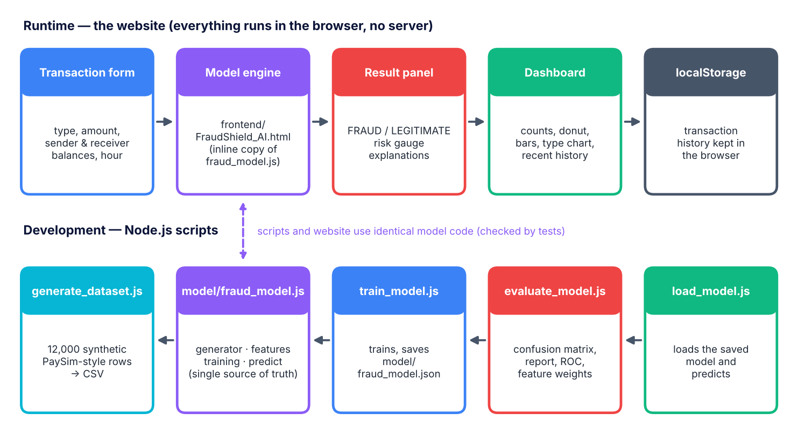
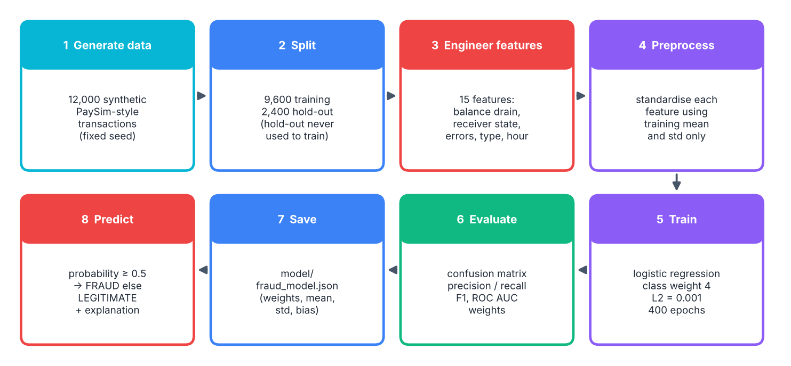
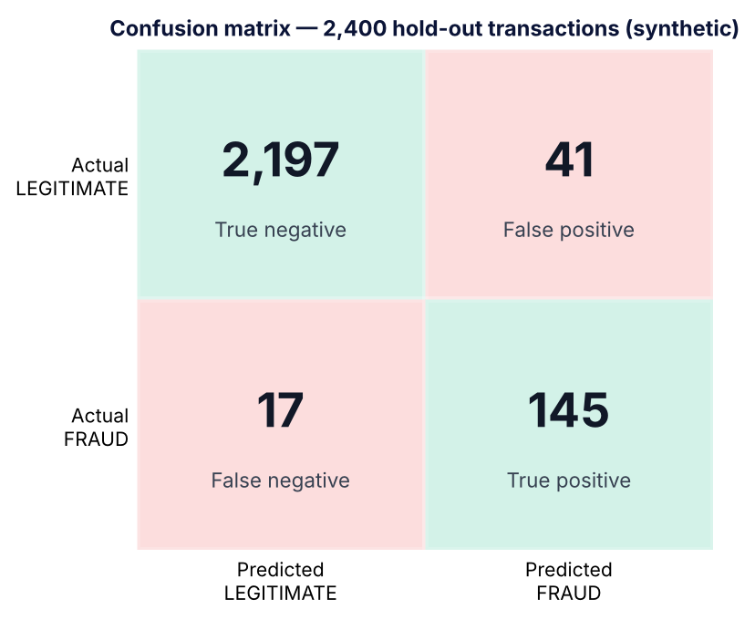
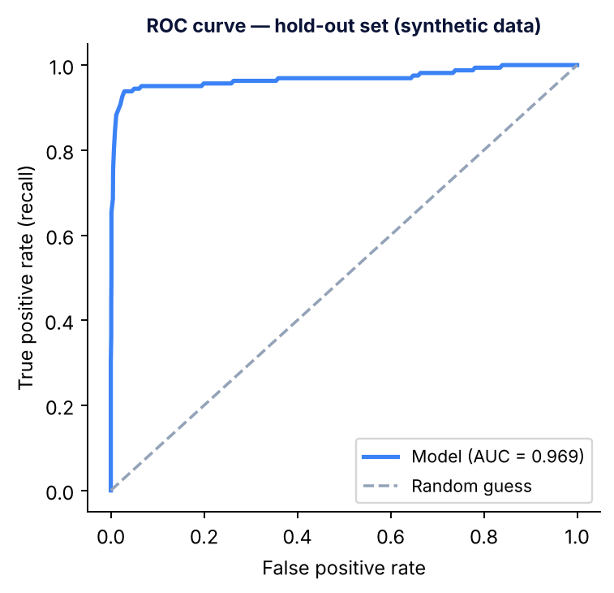
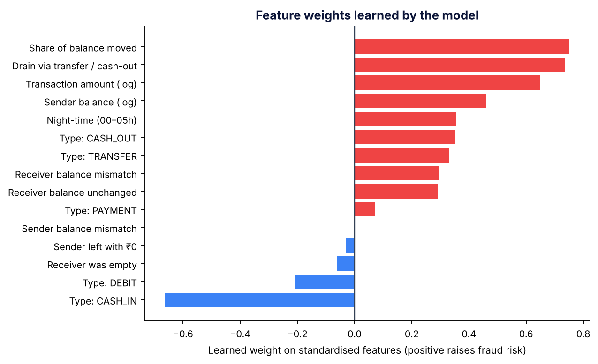
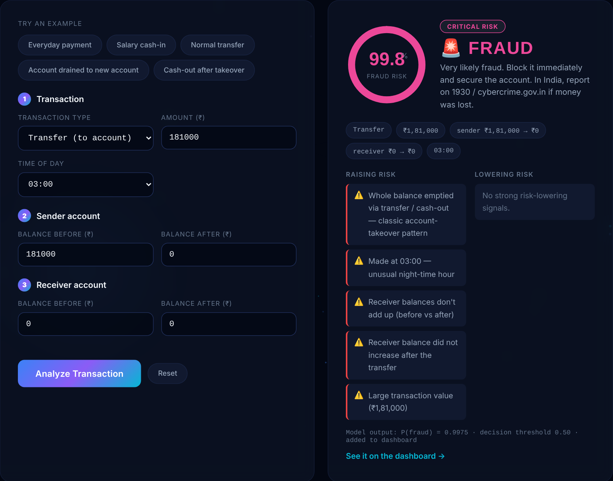
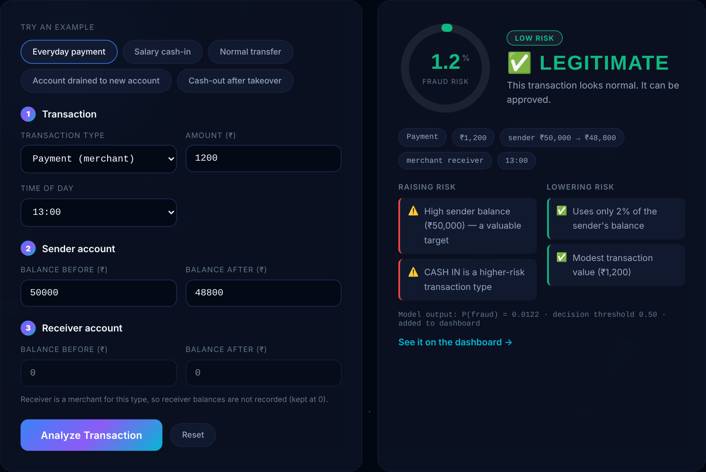

# 🛡️ FraudShield AI

**An AI-powered online transaction fraud detection system** — enter the details of a payment, and a machine-learning model returns **FRAUD** or **LEGITIMATE**, a fraud-risk score, and the reasons behind the decision. An interactive dashboard summarises everything you analyze.

> ⚠️ **Important:** the model is trained on **synthetic** (computer-generated) transaction data. The metrics in this README describe behaviour on that synthetic data and **do not represent real-world banking performance**. This is an educational / portfolio project, not a production fraud-prevention system.


**Live demo:** after you enable GitHub Pages for this repository (Settings → Pages → *Deploy from a branch* → `main` / root) the site is available at `https://vaishnavitomer22.github.io/FraudShield-AI/`. You can also simply open `frontend/FraudShield_AI.html` in any browser.

---

## Table of contents

1. [Problem statement](#1-problem-statement) · 2. [Motivation](#2-motivation) · 3. [Objectives](#3-objectives) · 4. [Key features](#4-key-features) · 5. [Technologies](#5-technologies-used) · 6. [Architecture](#6-system-architecture) · 7. [ML workflow](#7-machine-learning-workflow) · 8. [Dataset](#8-dataset-description) · 9. [Preprocessing](#9-data-preprocessing) · 10. [Model selection](#10-model-selection) · 11. [Evaluation](#11-model-evaluation-metrics) · 12. [Confusion matrix](#12-confusion-matrix) · 13. [Interpretation](#13-feature-importance--model-interpretation) · 14. [Screenshots](#14-application-screenshots) · 15. [Installation](#15-installation) · 16. [How to run](#16-how-to-run-the-project) · 17. [Testing](#17-testing) · 18. [Future improvements](#18-future-improvements) · 19. [Limitations](#19-limitations) · 20. [Author](#20-author-information)

---

## 1. Problem statement
Online payments are fast and hard to reverse, so fraudsters move stolen money quickly. A typical attack is **account takeover**: the attacker empties a victim's account into a new "mule" account and cashes it out within minutes. Simple checks (for example validating a phone number) never look at the transaction itself. A useful system must examine the **transaction attributes** — type, amount, and the sender's and receiver's balances — and decide immediately whether it looks fraudulent.

## 2. Motivation
Rule-based filters ("block anything above ₹X") are easy to evade and block genuine customers. Machine learning can learn *combinations* of signals from labelled examples. This project shows the complete path — data, features, training, evaluation, explanation, dashboard — in a form that is small enough to read end-to-end.

## 3. Objectives
- Classify online financial transactions as **FRAUD** or **LEGITIMATE** with a **risk score taken from the real model output**.
- Use transaction type, amount, sender balance and receiver balance (PaySim-style schema).
- Explain every verdict in plain language.
- Evaluate honestly on data the model never saw during training.
- Provide a dashboard whose numbers come only from the transactions analyzed.
- Provide a clean, responsive interface that works on mobile and desktop with no login and no server.

## 4. Key features
| Feature | Details |
|---|---|
| Transaction analyzer | Type, amount, sender balance before/after, receiver balance before/after, time of day; inputs validated |
| Automatic balance calculation | "Balance after" fields are filled in automatically (and stay editable) |
| Verdict + risk gauge | FRAUD / LEGITIMATE, animated gauge, probability to 4 decimals, risk level (low / medium / high / critical) |
| Explanations | "Raising risk" and "Lowering risk" factors using the user's own numbers |
| Dashboard | Totals, fraudulent vs legitimate counts, value flagged, donut chart, recent-risk bars, breakdown by type, model metrics, confusion matrix, transaction history |
| Persistence | History is kept in the browser's `localStorage`; **Clear dashboard** resets it |
| Test-set samples | Optional button loads 25 stratified transactions from the **held-out test set**, labelled as samples with their true label |
| Responsive UI | Mobile menu, tablet and desktop layouts; dark navy theme with gradient branding |
| Privacy | No server, no API, no login; nothing leaves the device |

## 5. Technologies used
- **HTML5, CSS3, vanilla JavaScript** — website, model, charts (inline SVG).
- **Node.js ≥ 18** — dataset generation, training, evaluation and tests (zero runtime dependencies).
- **Playwright** *(optional, dev only)* — browser end-to-end tests.
- **Python + matplotlib** *(optional)* — only for drawing the diagrams/figures in `docs/`.

> The machine-learning model is implemented in **JavaScript**, so the repository does **not** contain FastAPI, scikit-learn or a `.pkl` file — they would not be the model the website actually runs.

## 6. System architecture


`model/fraud_model.js` is the **single source of truth**. The code between its `ML_START`/`ML_END` markers is copied verbatim into `frontend/FraudShield_AI.html`, and a test checks that both copies are identical, so the scripts and the website run exactly the same model.

```
FraudShield-AI/
├── frontend/FraudShield_AI.html     # the complete website (UI + inline model + dashboard)
├── model/
│   ├── fraud_model.js               # generator, features, training, prediction, explanations
│   ├── train_model.js               # trains and saves model/fraud_model.json
│   ├── load_model.js                # loads the saved model and predicts
│   ├── evaluate_model.js            # confusion matrix, classification report, ROC, weights
│   ├── fraud_model.json             # saved model (weights, mean, std, bias)
│   └── evaluation_results.json      # saved evaluation output
├── data/
│   ├── generate_dataset.js          # writes the synthetic CSV dataset
│   └── sample_transactions.csv      # first 300 records (full CSV is git-ignored, re-creatable)
├── tests/                           # model.test.js (24 tests) · e2e.test.js (44 browser tests)
├── docs/                            # architecture / workflow diagrams, evaluation figures, generator script
├── screenshots/                     # real screenshots of the running application
├── index.html                       # redirects GitHub Pages to the website
├── package.json · requirements.txt · .gitignore · LICENSE · README.md
```

## 7. Machine learning workflow


1. Generate 12,000 synthetic PaySim-style transactions (fixed random seed).
2. Split into 9,600 training and 2,400 hold-out records.
3. Engineer 15 features from the raw fields.
4. Standardise each feature using the **training** mean and standard deviation only.
5. Train a class-weighted, L2-regularised logistic regression by gradient descent.
6. Evaluate on the hold-out set.
7. Save the parameters to `model/fraud_model.json`.
8. Predict: probability ≥ 0.5 → **FRAUD**, otherwise **LEGITIMATE**, with explanations.

## 8. Dataset description
No real banking data was used. `model/fraud_model.js` generates records that follow the schema of the **PaySim** mobile-money simulator (Lopez-Rojas, Elmir & Axelsson, 2016) using a fixed seed (`20260611`), so the same data and the same model are produced on every run. Run `node data/generate_dataset.js` to write the CSV.

**Columns:** `id, split, type, hour, amount, oldbalanceOrg, newbalanceOrig, oldbalanceDest, newbalanceDest, isFraud`

| | Legitimate | Fraudulent |
|---|---|---|
| Types | all five (PAYMENT, TRANSFER, CASH_OUT, CASH_IN, DEBIT) | TRANSFER or CASH_OUT |
| Share of TRANSFER/CASH_OUT records | 86% | 14% |
| Sender balance (median) | ₹15,000 | ₹1,20,000 |
| Amount moved | ~18% of balance on average; 4% empty the account | 85% empty the account; 15% move 50–95% |
| Receiver (transfer/cash-out) | 25% empty beforehand; credited in 92% | 60% empty and stay empty; 40% credited |
| Night-time (00–05h) | 7% | 35% |

0.5% of all labels are flipped as noise, and the legitimate and fraudulent distributions overlap on purpose so the task is not trivially separable.

**Generated dataset:** 12,000 records — PAYMENT 4,102 · CASH_OUT 3,619 · CASH_IN 2,290 · TRANSFER 1,499 · DEBIT 490. Fraud: 610 of 9,600 training records (6.35%) and 162 of 2,400 test records (6.75%). A small number of PAYMENT/CASH_IN frauds exist only because of the label noise.

## 9. Data preprocessing
- **Feature engineering** (15 features) turns raw fields into signals:

| Feature | Meaning |
|---|---|
| `amt` | log of the transaction amount |
| `frac` | amount ÷ sender balance (share of balance moved) |
| `drain` | sender left with ₹0 |
| `drainRisky` | `drain` × (type is TRANSFER or CASH_OUT) |
| `errOrg`, `errDest` | balances before/after don't add up for sender / receiver |
| `destEmpty` | receiver was empty before (typical of mule accounts) |
| `destFlat` | receiver balance did not increase |
| `oldOrg` | log of sender balance |
| `night` | hour between 00 and 05 |
| `t_PAYMENT … t_DEBIT` | one-hot encoding of the transaction type (5 features) |

- **Standardisation:** `(x − mean) / std`, with mean and std computed on the **training set only**, to avoid leaking information from the test set.
- **Imbalance:** fraud examples get a loss weight of 4 during training.

## 10. Model selection
A **logistic regression** was chosen because it outputs a probability (used directly as the risk score), is fast enough to train in the browser in about a second, and is easy to explain: each feature's contribution is its weight × standardised value. Training: full-batch gradient descent, 400 epochs, learning rate 0.3, L2 = 0.001, fraud class weight 4. *Other models (random forest, gradient boosting) were not compared in this repository; see [Future improvements](#18-future-improvements).*

## 11. Model evaluation metrics
Computed by `node model/evaluate_model.js` on the **2,400 hold-out transactions** (synthetic data):

| Metric | Value |
|---|---|
| Accuracy | **97.58%** (≈ 97.6%) |
| Precision (fraud) | **77.96%** (≈ 78.0%) |
| Recall (fraud) | **89.51%** (≈ 89.5%) |
| F1-score (fraud) | 83.33% |
| ROC AUC | **0.9688** (≈ 0.969) |

Classification report:

| Class | Precision | Recall | F1 | Support |
|---|---|---|---|---|
| LEGITIMATE | 0.992 | 0.982 | 0.987 | 2,238 |
| FRAUD | 0.780 | 0.895 | 0.833 | 162 |
| macro avg | 0.886 | 0.938 | 0.910 | 2,400 |
| weighted avg | 0.978 | 0.976 | 0.977 | 2,400 |

Moving the decision threshold trades precision against recall (from `evaluation_results.json`):

| Threshold | Precision | Recall | False positives | False negatives |
|---|---|---|---|---|
| 0.3 | 71.1% | 92.6% | 61 | 12 |
| 0.4 | 75.0% | 90.7% | 49 | 15 |
| **0.5 (used)** | **78.0%** | **89.5%** | **41** | **17** |
| 0.6 | 80.6% | 89.5% | 35 | 17 |
| 0.7 | 84.5% | 87.7% | 26 | 20 |

> These numbers are for synthetic data generated by the same author-defined process the model was trained on. Real bank data is messier, so real-world performance would differ — typically for the worse.

## 12. Confusion matrix
| | Predicted LEGITIMATE | Predicted FRAUD |
|---|---|---|
| **Actual LEGITIMATE** | 2,197 (true negatives) | 41 (false positives) |
| **Actual FRAUD** | 17 (false negatives) | 145 (true positives) |

<p align="center"> </p>

## 13. Feature importance / model interpretation
Because the features are standardised, the learned weights are directly comparable (positive = raises fraud risk):



The model learned the expected pattern: the **share of the balance moved** (+0.75) and **draining the account via transfer/cash-out** (+0.73) are the strongest fraud signals, followed by large amounts (+0.65), high sender balances (+0.46) and night-time activity (+0.35). `CASH_IN` has a strongly negative weight (−0.66) because the generator creates (almost) no fraud for that type. Two cautions: `errOrg` has weight 0 because sender balances were always consistent in the synthetic data, and weights of correlated features (for example `destEmpty`) should not be interpreted individually.

## 14. Application screenshots
| Analyzer — FRAUD | Analyzer — LEGITIMATE |
|---|---|
|  |  |


<p align="center"></p>

## 15. Installation
Requirements: **Node.js 18 or newer** (tested on Node 22). Python is optional (diagrams only).

```bash
git clone https://github.com/vaishnavitomer22/FraudShield-AI.git
cd FraudShield-AI

npm install                      # only needed for the browser tests (installs Playwright)
npx playwright install chromium  # only needed for the browser tests
pip install -r requirements.txt  # only needed to redraw the figures
```

## 16. How to run the project
**The website** — no installation needed: open `frontend/FraudShield_AI.html` in Chrome, Edge, Firefox or Safari.

**The machine-learning pipeline:**
```bash
node data/generate_dataset.js    # writes data/synthetic_transactions.csv (+ sample file)
node model/train_model.js        # trains and saves model/fraud_model.json
node model/evaluate_model.js     # confusion matrix, classification report, ROC, weights
node model/load_model.js         # loads the saved model and predicts an example
node model/load_model.js '{"type":"CASH_OUT","hour":2,"amount":215000,"oldOrg":215000,"newOrg":0,"oldDest":21182,"newDest":236182}'
python docs/generate_figures.py  # optional: redraw docs/*.png
```
**Publish it** — Settings → Pages → *Deploy from a branch* → `main` / `(root)`; `index.html` redirects to the website.

## 17. Testing
```bash
node tests/model.test.js                  # 24 tests, no dependencies
node tests/e2e.test.js                    # 44 browser tests (needs Playwright)
```
`model.test.js` checks the headline metrics (97.6 / 78.0 / 89.5 / 0.969), the data split, deterministic training, example predictions, save/load round-trip, and that the model inside the website is identical to `model/fraud_model.js`. `e2e.test.js` drives the real page in headless Chromium: the *Get Started Free* button, all navigation links and buttons, all 25 footer links, the five example transactions, input validation, automatic balance calculation, dashboard counts, persistence, *Clear dashboard*, the mobile menu, absence of sideways scrolling at seven screen widths, and absence of console errors.

## 18. Future improvements
- Train on a real public dataset (for example the full PaySim data) and compare logistic regression with random forest and gradient boosting.
- Add a Python/FastAPI back end (scikit-learn) so the model can be served through an API and retrained.
- Add customer-history features (usual amount, trusted devices, recent velocity).
- Use SHAP values for explanations of non-linear models; add a configurable threshold with a precision–recall curve.
- CSV upload for batch analysis; database storage; analyst login and alerting.

## 19. Limitations
- **Synthetic data only** — metrics do not reflect real-world performance; the test data comes from the same generator as the training data.
- A linear model cannot capture complex interactions.
- Each transaction is analysed on its own, with no customer history, device or location data.
- Transactions are typed in by hand; there is no bank or payment-gateway integration.
- History is stored only in the local browser (`localStorage`).
- The 0.5 threshold and the class weight of 4 were chosen by hand, not tuned.
- Several sections of the original landing page (e.g. testimonials, platform logos) are illustrative marketing copy, not evidence.

## 20. Author information
- **Author:** vaishnavitomer22 — <https://github.com/vaishnavitomer22>
- **Programme / institution:** *B.Tech Computer Science — add your college name and year here*
- **Contact:** *add your email or LinkedIn here*

**Reference:** Lopez-Rojas, E. A., Elmir, A., Axelsson, S. (2016). *PaySim: A financial mobile money simulator for fraud detection.* 28th European Modeling and Simulation Symposium (EMSS).

**License:** [MIT](LICENSE)
